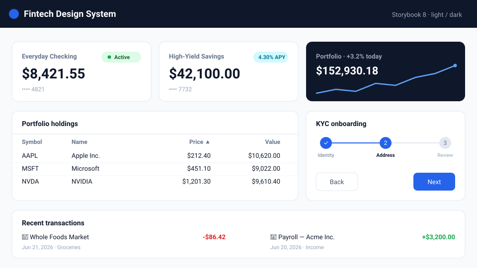
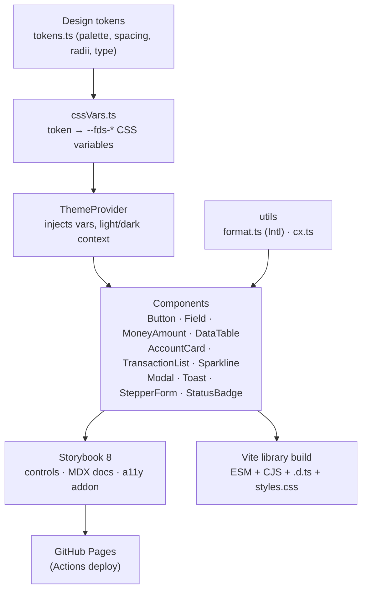

# Fintech Design System

[](https://github.com/maddoxk/frontend-fintech-design-system/actions/workflows/pages.yml)
[](./LICENSE)


An open-source, **accessible** React 18 + TypeScript design system for building
fintech applications — banking dashboards, brokerage apps, payment flows and KYC
onboarding. Every component is themeable via design tokens (light / dark), wired
for ARIA and keyboard navigation, and documented in a live Storybook with
controls, MDX docs, and an automated accessibility (axe) addon.

### ▶ Live Storybook: **https://maddoxk.github.io/frontend-fintech-design-system/**



> The image above is a static preview. Explore every component interactively —
> toggle light/dark, tweak controls, and run a11y checks — in the
> [live Storybook](https://maddoxk.github.io/frontend-fintech-design-system/).

---

## Why

Fintech UIs share a recurring vocabulary: money amounts, account cards,
transaction feeds, sortable holdings tables, trend charts, status pills, and
multi-step KYC flows. This library packages that vocabulary as small,
dependency-light, accessible primitives so product teams can ship correct,
consistent interfaces fast.

- **Accessible by construction** — native elements where possible, ARIA roles,
  `aria-sort`, `aria-live` toasts, focus-trapped modal, `aria-current` stepper,
  visible focus rings. The Storybook **Accessibility** tab runs axe on every story.
- **Themeable** — a single token source (`src/tokens/tokens.ts`) is emitted as
  `--fds-*` CSS custom properties by `ThemeProvider`, giving instant light/dark.
- **Currency- and locale-aware** — formatting built on the native `Intl` API,
  including zero-decimal currencies (JPY) and per-locale grouping.
- **Light footprint** — zero runtime dependencies beyond React. Charts are pure
  SVG; no charting library.

## Components

| Component | Highlights |
| --- | --- |
| `ThemeProvider` / `useTheme` | Emits token CSS variables; light/dark switching. |
| `Button` | `primary` / `secondary` / `ghost` / `danger`, 3 sizes, loading state (`aria-busy`). |
| `Field` | Labeled input with hint/error, auto-wired `htmlFor`, `aria-describedby`, `aria-invalid`. |
| `MoneyAmount` | `Intl`-based currency formatting; optional colorize + explicit sign. |
| `StatusBadge` | Semantic-tone status pills (settled / pending / declined…). |
| `AccountCard` | Account summary: name, balance, masked number, status, trailing slot. |
| `TransactionList` | Accessible transaction feed with localized dates + colorized amounts. |
| `DataTable` | Generic, **sortable** (`aria-sort`, keyboard) and optionally **virtualized** table. |
| `Sparkline` / `AreaChart` | Pure-SVG trend charts with accessible labels. |
| `Modal` | `role="dialog"` `aria-modal`, focus trap, Escape to close, focus restoration. |
| `ToastProvider` / `useToast` | Imperative toast API rendered into a polite live region. |
| `StepperForm` | Multi-step KYC-style form with progress rail + per-step validation. |

## Quick start

```bash
npm install   # then explore locally
npm run storybook        # dev Storybook on :6006
npm test                 # vitest (35 tests)
npm run build            # build the distributable library (tsc + vite lib)
npm run build-storybook  # static Storybook -> storybook-static/
```

### Using the components

```tsx
import {
  ThemeProvider,
  AccountCard,
  MoneyAmount,
  Button,
  useTheme,
} from 'fintech-design-system';
import 'fintech-design-system/styles.css';

function ThemeToggle() {
  const { theme, toggleTheme } = useTheme();
  return <Button variant="ghost" onClick={toggleTheme}>Theme: {theme}</Button>;
}

export function App() {
  return (
    <ThemeProvider defaultTheme="light">
      <ThemeToggle />
      <AccountCard
        name="Everyday Checking"
        balance={8421.55}
        currency="USD"
        accountNumber="•••• 4821"
        status={{ label: 'Active', tone: 'positive' }}
      />
      <MoneyAmount value={-91.4} colorize showSign />
    </ThemeProvider>
  );
}
```

## Customizing the accent

```tsx
<ThemeProvider accent="emerald">…</ThemeProvider> {/* blue | indigo | emerald | violet | rose | graphite */}
<ThemeProvider accent={{ base: '#0f766e', hover: '#115e59', onAccent: '#fff' }}>…</ThemeProvider>
```

The accent overrides `--fds-color-brand`, `-brand-hover`, `-brand-text` and `-focus-ring` in light and dark mode,
and nested providers can scope their own accent. `useTheme()` returns `accent` and `setAccent`; with `storageKey`
set the choice persists under `${storageKey}:accent`. Unknown names fall back to `blue`.

## Architecture



**Design principles**

- **Single source of truth for design** — colors/spacing/typography live only in
  `tokens.ts`. Components reference `var(--fds-*)`; theming never touches JS.
- **Composition over configuration** — e.g. `AccountCard` accepts a `trailing`
  slot so a `Sparkline` drops in without coupling.
- **Accessibility is not optional** — keyboard and ARIA behavior is built into
  each component, then verified by the Storybook a11y addon.

## Project structure

```
src/
  tokens/tokens.ts        Design tokens + semantic light/dark color roles
  theme/                  ThemeProvider, useTheme, cssVars (token → CSS vars)
  utils/                  format.ts (Intl money/date/percent), cx.ts
  components/             11 component modules
  stories/                Storybook stories + Introduction.mdx + token docs
  __tests__/              vitest + @testing-library/react (35 tests)
.storybook/               Storybook 8 config (react-vite, a11y, docs)
.github/workflows/        Pages deploy (test → build Storybook → deploy)
```

## Testing

`vitest` + `@testing-library/react` + `jsdom`, covering formatting, theming,
focus/keyboard behavior, sorting, and the stepper flow.

```bash
npm test
# Test Files  9 passed (9)
#      Tests  35 passed (35)
```

## Tech stack

React 18 · TypeScript 5 · Vite 5 (library build) · Storybook 8 (`react-vite`) ·
`@storybook/addon-a11y` · Vitest 2 · Testing Library · native `Intl` · pure SVG
charts · GitHub Actions → GitHub Pages.

## Deployment

Every push to `main` runs the `.github/workflows/pages.yml` workflow: install →
`npm test` → build the static Storybook with the correct Pages base path →
deploy `storybook-static/` to GitHub Pages. The base path is
`/frontend-fintech-design-system/` and a `.nojekyll` file is added so asset
folders are served as-is.

## License

[MIT](./LICENSE) © 2026 Maddox Krape
